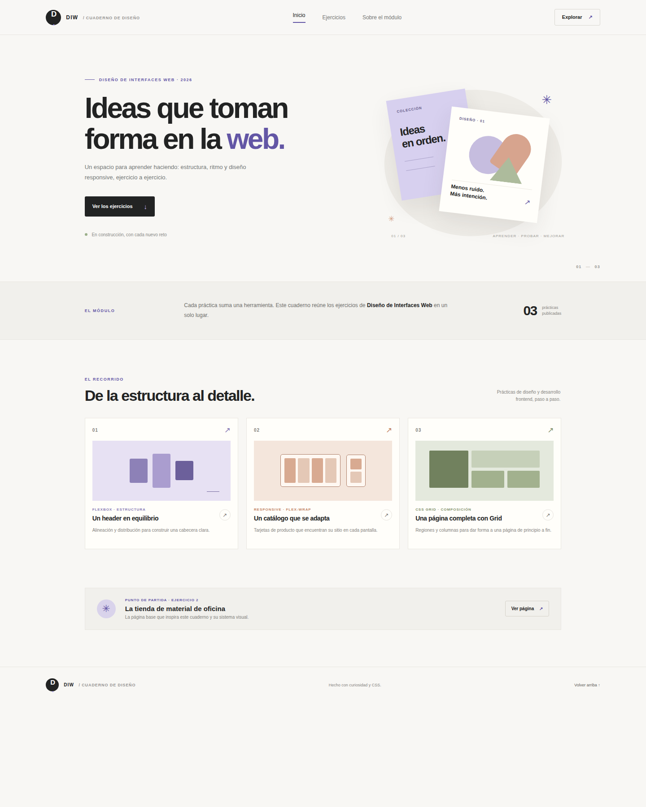

# Entrega · Actividad C7

**Módulo:** Diseño de Interfaces Web (DIW)

- **Repositorio:** [DAW-Diseno-de-Interfaz](https://github.com/altedante4-cyber/DAW-Diseno-de-Interfaz)
- **Web publicada en GitHub Pages:** [Abrir página de inicio](https://altedante4-cyber.github.io/DAW-Diseno-de-Interfaz/)

## Captura de la web

